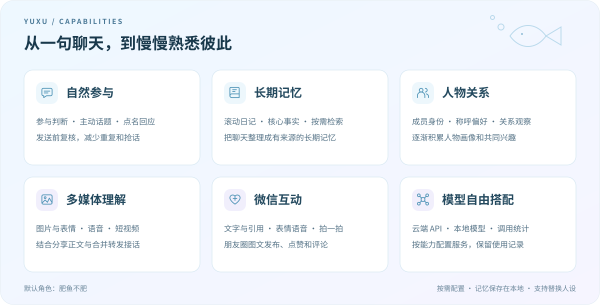

<p align="center">
  
</p>

<h1 align="center">鱼叙 Yuxu</h1>

<p align="center"><strong>会聊天，也会慢慢熟悉你。</strong></p>
<p align="center">长期记忆 · 人物关系 · 自主参与</p>
<p align="center">
  <a href="#先运行离线演示">快速开始</a> ·
  <a href="docs/configuration.md">配置指南</a> ·
  <a href="docs/features.md">功能边界</a>
</p>

一个具有长期记忆、人物关系和自主参与能力的微信群聊 Agent。默认角色是“肥鱼不肥”，可以替换人设，也可以接入自己的云端或本地模型。

这是公开源码版本，包含代码、合成测试样例与展示素材。开发者的微信账号、聊天记录、Cookie、API Key、人物档案、私人图库和旧项目 Git 历史不随仓库发布。每位使用者需要配置自己的账号和模型服务。

应用层离线测试和当前 Windows 原生测试已通过，干净目录的安装、演示与启动器也已验证。具体结果和平台边界见[验证记录](docs/validation.md)；离线验证不替代使用者自己账号的真实登录和收发验收。

## 功能



| 模块 | 内容 |
| --- | --- |
| 群聊 | 多群隔离、参与判断、点名/@/拍一拍回应、主动话题、发送前复核与去重 |
| 记忆 | 消息 Inbox、容量触发的滚动日记、Mem0 与 SQLite、相关记忆检索 |
| 人物关系 | 稳定身份与昵称映射、有来源的人物观察、兴趣标签、亲密度、相处偏好、关系与活动记录 |
| 多媒体 | 图片/表情理解和内容缓存、语音转写、普通短视频抽帧和转写、分享正文、合并转发 |
| 发送 | 文字、高清图片、类型 47 表情、语音、引用回复、@、拍一拍 |
| 朋友圈 | 同一登录态下的时间线和图片读取、图文发布、选题调度、点赞评论及评论回复、近况记忆 |
| 兴趣 | 跨天事项跟进、共同兴趣订阅、可选热点来源和新梗学习 |
| 运维 | 模型路由、逐次调用与 Token 统计、进程守护、30 分钟在线检查、Windows 启动器 |

功能边界见 [功能说明](docs/features.md)。代码和离线测试存在不代表任意微信版本、模型或网络环境都已完成真实验收。

## 先运行离线演示

安装 Node.js 24（至少 24.22.1，低于 25）后，在项目根目录运行：

```powershell
npm.cmd ci
npm.cmd run demo
npm.cmd test
```

离线演示不需要微信登录或模型 Key。测试使用模拟接口和临时数据库，不应使用生产配置执行测试。

## 连接自己的微信

完整启动流程当前面向 Windows x64。需要 Node.js 24；编译原生引擎还需要 Rust 1.93.1、C/C++ 编译器和 Perl。详见 [原生构建](docs/native-build.md)。

```powershell
npm.cmd run wechat:build
npm.cmd run launchers:build
Copy-Item .env.example .env
& .\Yuxu-WeChat.exe
```

扫码/手机确认后，用以下命令查看自己的账号与群。不要把这些输出贴到公开 Issue：

```powershell
npm.cmd run wechat -- accounts list
npm.cmd run wechat -- threads list
```

把你自己的账号 ID 和授权群 ID 填入 setup 命令；下面的值只是格式示例：

```powershell
npm.cmd run setup -- --account account-example --group 10001@chatroom
```

编辑 `.env`，选择模型服务并填写自己的凭据。首次启动默认生成候选回复，不发送消息。确认配置后，把需要的发送开关改为 `1`：

```powershell
npm.cmd start
```

以后可以双击 `Yuxu-Start.exe`。另一个目录中已有微信服务运行时，本安装不会接管它。首版源码不附带工作站 SSH 转发；将模型端点指向你已配置好的服务即可。

## 配置和开发

- [模型、发送和可选功能配置](docs/configuration.md)
- [隐私、运行数据与发布检查](docs/privacy.md)
- [原生引擎构建和来源](docs/native-build.md)
- [功能范围与限制](docs/features.md)
- [验证结果与已知限制](docs/validation.md)
- [人设样例](docs/persona-examples.md)

`packages/` 是 Agent 业务代码；`skills/` 是运行提示词；`scripts/` 是命令入口；`native/wechat/` 包含定制微信引擎源码及原许可；`tests/` 使用合成样例。旧 `SOCIOMEM_*` 环境变量和部分内部目录名保留为兼容接口，不代表需要开发者的私人部署。

本项目使用 MIT 许可证，第三方组件继续遵循各自许可证，见 [THIRD_PARTY_NOTICES.md](THIRD_PARTY_NOTICES.md)。
